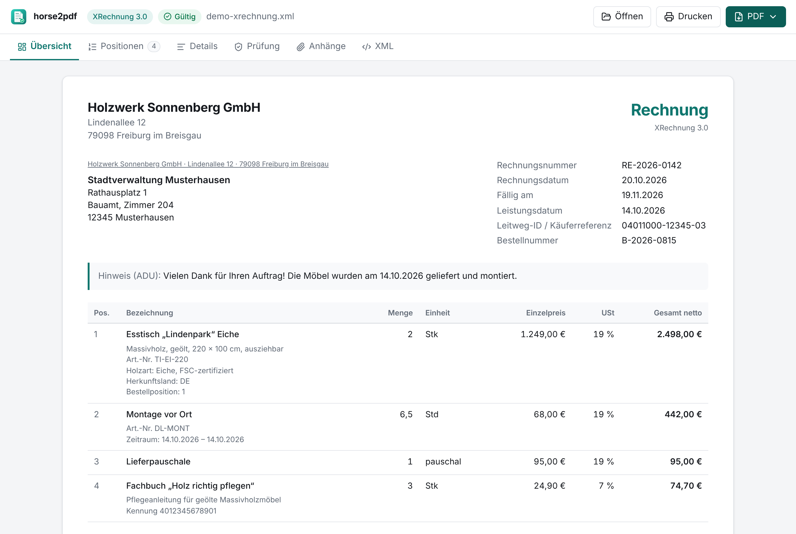
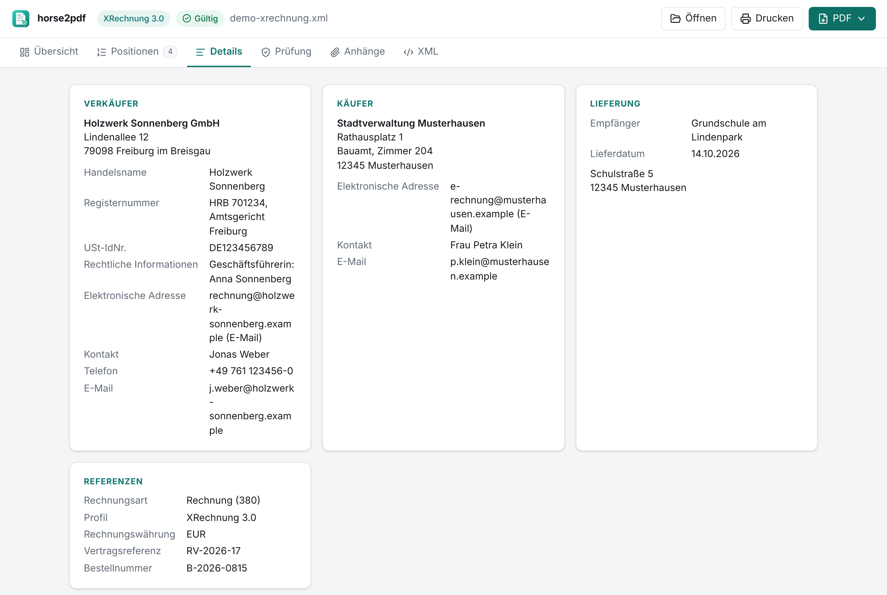
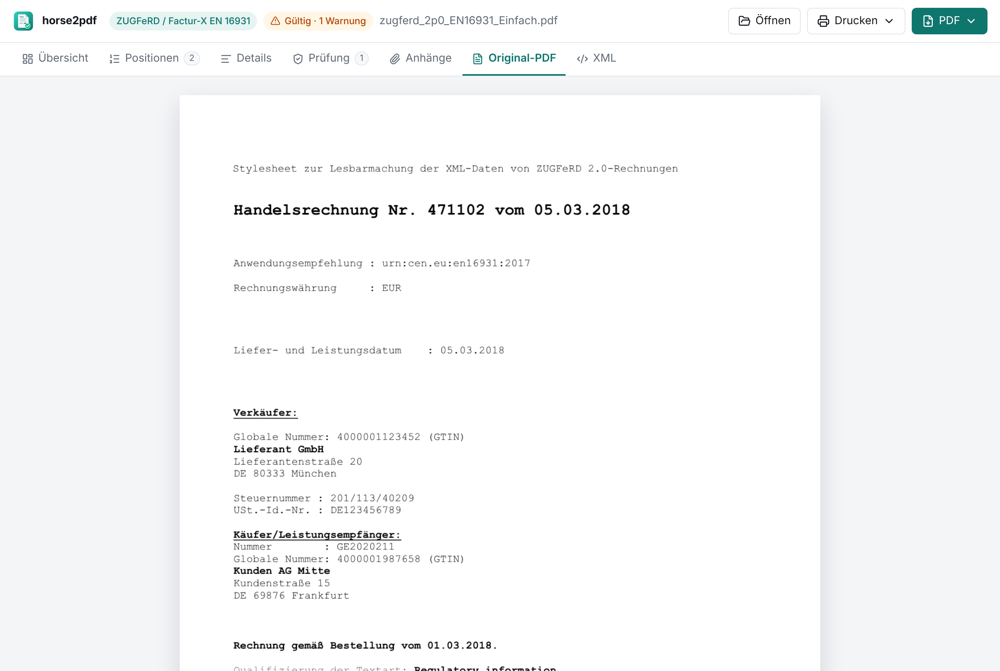
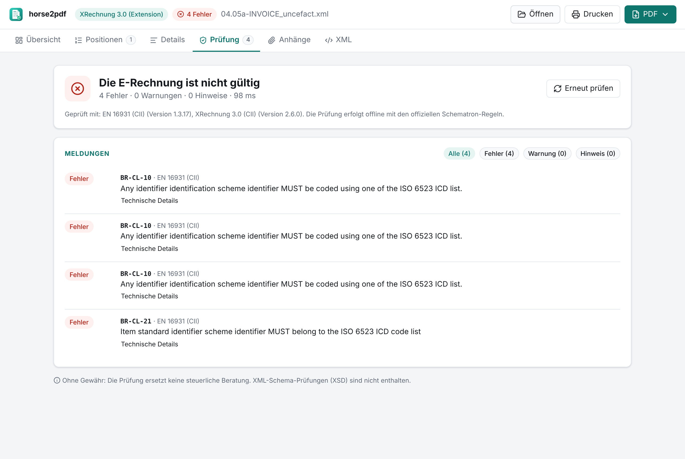

<p align="center">
  
</p>

<h1 align="center">horse2pdf</h1>

<p align="center">
  <b>E-Rechnungen anzeigen, prüfen, drucken und als PDF exportieren – modern, schnell und komplett offline.</b><br>
  XRechnung (UBL &amp; CII) · ZUGFeRD 2.x · Factur-X · Peppol BIS Billing 3.0<br>
  Native Desktop-App für <b>macOS</b> und <b>Windows</b> (und Linux)
</p>

<p align="center">
  <a href="../../actions/workflows/ci.yml"></a>
  <a href="../../releases/latest"></a>
  
</p>

<p align="center">
  
</p>

---

## Was kann horse2pdf?

- **Alle gängigen E-Rechnungsformate öffnen** – per Doppelklick, „Öffnen mit…“, Drag & Drop oder Dateidialog:
  - XRechnung 3.x in **UBL** (Invoice & CreditNote) und **UN/CEFACT CII**, inkl. *Extension* (Unterpositionen, Zahlungen an Dritte)
  - **ZUGFeRD 2.x / Factur-X** als PDF (die eingebettete XML wird automatisch gefunden) oder als reine XML – alle Profile von MINIMUM bis EXTENDED
  - **Peppol BIS Billing 3.0** (auch mit SBDH-Umschlag)
- **Alles auf einen Blick**: Die Rechnung wird wie ein Papierbeleg dargestellt – Absender, Empfänger, Eckdaten, Positionen, Summen, Umsatzsteuer und Zahlungsinformationen mit **GiroCode** (QR zum Bezahlen per Banking-App).
- **Unterseiten für Details**: Positionen (durchsuchbar, mit Unterpositionen), Beteiligte, Lieferung, Referenzen, Nachlässe/Zuschläge, Anhänge, Original-PDF und XML-Quelltext. Die Ansicht **„Alle Angaben nach EN 16931“** listet jeden Geschäftsbegriff mit BT-Nummer.
- **Prüfung mit den offiziellen Regelwerken** – EN 16931 (CEN), XRechnung (KoSIT) und Peppol BIS – direkt im Programm, ohne Java, ohne Internet.
- **PDF-Export**, schön formatiert, mit allen Daten inkl. Anhang „Alle Angaben“, Prüfergebnis und der **original XML als PDF-Anhang**. Ist bereits ein Rechnungs-PDF eingebettet (ZUGFeRD), wird **dieses Original** standardmäßig gespeichert bzw. gedruckt.
- **Drucken** über den nativen Druckdialog – wahlweise die Original-PDF oder die aufbereitete Ansicht.
- **Datenschutz**: Keine Cloud, keine Telemetrie. Die Dateien verlassen nie den Rechner.

<table>
  <tr>
    <td></td>
    <td></td>
  </tr>
  <tr>
    <td></td>
    <td></td>
  </tr>
</table>

## Installation

Fertige Installationspakete gibt es unter **[Releases](../../releases/latest)**:

| System | Datei |
| ------ | ----- |
| macOS 11+ (Apple Silicon & Intel) | `horse2pdf_<version>_universal.dmg` |
| Windows 10/11 | `horse2pdf_<version>_x64-setup.exe` (empfohlen) oder `…_x64_de-DE.msi` |
| Linux | `.AppImage`, `.deb` |

> **Hinweis zu unsignierten Builds:** Solange kein Code-Signing-Zertifikat hinterlegt ist (siehe
> [docs/RELEASING.md](docs/RELEASING.md)), warnen macOS bzw. Windows beim ersten Start.
> macOS: Rechtsklick auf die App → *Öffnen* (oder `xattr -cr /Applications/horse2pdf.app`).
> Windows: SmartScreen → *Weitere Informationen* → *Trotzdem ausführen*.

## Bedienung

| Aktion | So geht's |
| ------ | --------- |
| Rechnung öffnen | Datei ins Fenster ziehen, Doppelklick (Dateizuordnung) oder <kbd>⌘/Strg</kbd>+<kbd>O</kbd> |
| Drucken | Button *Drucken* oder <kbd>⌘/Strg</kbd>+<kbd>P</kbd> |
| PDF speichern | Button *PDF* oder <kbd>⌘/Strg</kbd>+<kbd>E</kbd> |
| Prüfergebnis | Badge oben (*Gültig* / *n Fehler*) oder Tab *Prüfung* |

## Wie zuverlässig ist die Anzeige?

Rechnungsdaten dürfen nicht verfälscht werden – keine vertauschten Felder, keine Zahlendreher.
Deshalb wird jede Änderung automatisch gegen **echte Rechnungen** getestet (über 120 Beispieldateien
aus der KoSIT-Testsuite, den CEN- und Peppol-Beispielen und dem ZUGFeRD-Korpus):

1. **Orakel-Test**: Für jede Datei wird jeder Geschäftsbegriff (BT) mit dem Ergebnis der offiziellen
   **KoSIT-Referenz-Transformation** verglichen (dieselbe Logik nutzt z. B. der ELSTER-Viewer).
   Bewusste, begründete Abweichungen sind im Test einzeln dokumentiert.
2. **UBL ↔ CII**: Dieselbe Rechnung in beiden Syntaxen muss exakt dieselben Daten ergeben.
3. **Rechenregeln**: Summen, Umsatzsteuer und Zahlbetrag werden nach den EN-16931-Regeln nachgerechnet.
4. **PDF-Export**: Für jede Datei wird das PDF erzeugt und geprüft, dass alle Beträge, Positionen
   und die eingebettete XML wirklich darin stehen.
5. **Prüfregeln**: Die Ergebnisse der offiziellen Schematron-Regeln sind je Datei als Snapshot
   festgeschrieben; manipulierte Rechnungen (z. B. falscher Zahlbetrag, fehlende Leitweg-ID,
   falsche IBAN-Prüfziffer) müssen erkannt werden.
6. **E2E-Tests** im Browser mit derselben Sicherheitsrichtlinie (CSP) wie die Desktop-App.

## Entwicklung

Voraussetzungen: [Node.js 22+](https://nodejs.org), [pnpm 10](https://pnpm.io),
[Rust](https://rustup.rs) und die [Tauri-Voraussetzungen](https://v2.tauri.app/start/prerequisites/)
für dein Betriebssystem.

```bash
pnpm install
pnpm app:dev        # Desktop-App mit Hot Reload
pnpm dev            # nur die Oberfläche im Browser (http://localhost:1420)
pnpm check          # Lint + Typecheck + Unit-Tests
pnpm test:e2e       # E2E-Tests (Playwright)
pnpm app:build      # Installer für das aktuelle System bauen
```

Beim ersten Build werden die offiziellen Prüfregeln (versionsgepinnt und per SHA-256 verifiziert)
heruntergeladen und für die App kompiliert (`pnpm assets`).

Weiterführend:

- [docs/ARCHITECTURE.md](docs/ARCHITECTURE.md) – Aufbau, Datenfluss, Designentscheidungen
- [docs/RELEASING.md](docs/RELEASING.md) – automatische Releases, Code-Signing, Regelwerke aktualisieren
- [AGENTS.md](AGENTS.md) – Leitfaden für KI-Agenten und Mitwirkende
- [CONTRIBUTING.md](CONTRIBUTING.md)

## Lizenz

horse2pdf steht unter der [MIT-Lizenz](LICENSE). Mitgelieferte Komponenten Dritter
(SaxonJS, pdf.js, pdfmake, Prüfregeln von CEN, KoSIT und OpenPEPPOL, …) stehen unter ihren
eigenen Lizenzen – siehe [THIRD_PARTY_NOTICES.md](THIRD_PARTY_NOTICES.md).

> horse2pdf ist eine Anzeige- und Prüfhilfe. Rechtlich maßgeblich ist stets die strukturierte
> E-Rechnung (XML). Keine Gewähr für steuerliche oder rechtliche Richtigkeit.
